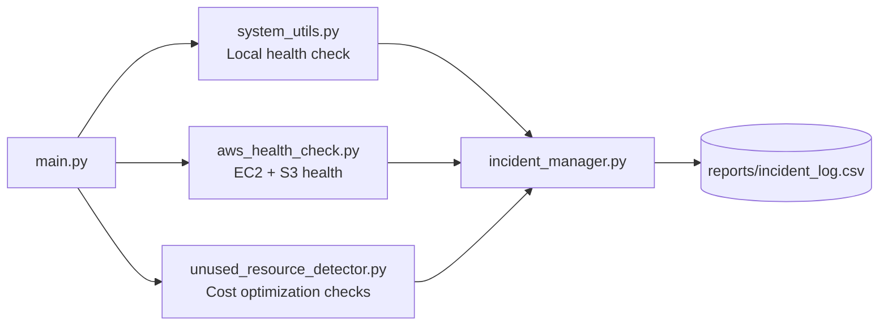

# Cloud Infrastructure Monitoring & Incident Management System

A simple Python + boto3 automation tool that checks the health of AWS
resources (EC2, S3), finds unused resources that are quietly costing
money, and logs any problems found as "incidents" in a report file.

Built as a hands-on project to practice real tasks a **Junior Cloud
Engineer** or **Cloud Support Engineer** does day-to-day: health checks,
cost optimization, and basic incident tracking.

---

## Why I built this

Cloud support and junior cloud roles involve a lot of repetitive checks:
"Are our servers healthy? Is anything broken? Are we wasting money on
resources nobody is using?" Instead of doing this manually in the AWS
Console every time, I automated it with Python and boto3 (AWS's Python
SDK) — the same tool used in real DevOps/Cloud teams.

---

## What it does

1. **Local System Health Check** — checks CPU, memory, and disk usage
   on the machine running the script (using `psutil`).
2. **AWS Health Check** — checks whether EC2 instances are running/stopped
   and whether S3 buckets are reachable (using `boto3`).
3. **Unused Resource Detection (Cost Optimization)** — finds:
   - EBS volumes that aren't attached to any instance (wasted storage cost)
   - Elastic IPs that are allocated but not attached to anything (wasted cost)
   - EC2 instances that are stopped but still around (candidates for cleanup)
4. **Incident Logging** — turns every problem found into a simple
   "incident" record (timestamp, resource, issue, severity), prints a
   summary, and saves everything to a CSV report.

---

## How it works (architecture)



Each part of the system is its own small file with one job — this makes
it easy to read, test, and extend (a common real-world practice called
**separation of concerns**).

---

## Tech stack

- **Python 3**
- **boto3** — AWS SDK for Python (talks to EC2 and S3)
- **psutil** — reads local system metrics (CPU/memory/disk)
- **AWS IAM** — for secure, limited-permission access to AWS
- **CSV** — simple, universal format for the incident report

---

## Project structure

```
cloud-infra-monitor/
├── main.py                      # Entry point — runs everything
├── config.py                    # Settings: AWS region, alert thresholds
├── system_utils.py              # Local system health (CPU/memory/disk)
├── aws_health_check.py          # EC2 & S3 health checks
├── unused_resource_detector.py  # Finds unused/wasted AWS resources
├── incident_manager.py          # Creates, prints, and saves incidents
├── requirements.txt              # Python dependencies
├── requirements-dev.txt          # + pytest, for running tests
├── tests/                        # pytest unit tests (mocked AWS calls)
│   ├── test_system_utils.py
│   ├── test_aws_health_check.py
│   ├── test_unused_resource_detector.py
│   └── test_incident_manager.py
└── reports/                       # Generated incident CSV reports
```

---

## Setup & Usage

### 1. Install dependencies
```bash
pip install -r requirements.txt
```

### 2. Configure AWS credentials
Create an IAM user in AWS with read-only access to EC2 and S3
(`AmazonEC2ReadOnlyAccess` and `AmazonS3ReadOnlyAccess` are enough),
then run:
```bash
aws configure
```
Enter your Access Key ID, Secret Access Key, and default region.

### 3. Set your region (optional)
Edit `AWS_REGION` in `config.py` if you're not using `us-east-1`.

### 4. Run it
```bash
python main.py
```

### Example output
```
Cloud Infrastructure Monitoring & Incident Management System
============================================================
== 1. Local System Health ==
   CPU: 4.2%  |  Memory: 38.1%  |  Disk: 61.5%

== 2. AWS Health Check (EC2 & S3) ==
   EC2 instances found: 3 (running: 1, stopped: 2)
   S3 buckets found: 4

== 3. Unused Resource Detection (Cost Optimization) ==
   Unattached EBS volumes: 1
   Unused Elastic IPs: 1
   Stopped EC2 instances: 2

== 4. Incident Report ==
⚠️  4 incident(s) found:
   HIGH: 0  |  MEDIUM: 1  |  LOW: 3

   [MEDIUM] EBS Volume (vol-0abc123): Unattached volume (20 GB) still incurring cost
   [LOW] Elastic IP (3.90.1.2): Allocated but not attached to any instance
   [LOW] EC2 Instance (i-0def456): Instance is stopped — review if still needed
   [LOW] EC2 Instance (i-0ghi789): Instance is stopped — review if still needed

📄 Full report saved to: reports/incident_log_20260927_101530.csv
```

If AWS credentials aren't configured, the AWS checks are skipped with a
clear message instead of crashing — the local system check still runs.

---

## Running the tests

The project includes a `pytest` test suite (14 tests) that checks each
module works correctly — without ever making a real AWS call. Real AWS
responses are "mocked" (faked) so the tests are fast, free, and don't
need credentials to run.

```bash
pip install -r requirements-dev.txt
pytest -v
```

```
tests/test_aws_health_check.py::test_check_ec2_health_counts_running_and_stopped PASSED
tests/test_aws_health_check.py::test_check_ec2_health_handles_missing_credentials PASSED
tests/test_aws_health_check.py::test_check_s3_health_flags_unreachable_buckets PASSED
tests/test_incident_manager.py::test_create_incident_has_all_expected_fields PASSED
tests/test_incident_manager.py::test_save_incidents_returns_none_when_list_is_empty PASSED
tests/test_incident_manager.py::test_save_incidents_writes_a_csv_file PASSED
tests/test_incident_manager.py::test_print_summary_with_no_incidents PASSED
tests/test_incident_manager.py::test_print_summary_with_incidents PASSED
tests/test_system_utils.py::test_get_system_details_returns_expected_keys PASSED
tests/test_system_utils.py::test_get_system_details_calls_psutil_correctly PASSED
tests/test_unused_resource_detector.py::test_find_unattached_ebs_volumes PASSED
tests/test_unused_resource_detector.py::test_find_unused_elastic_ips_only_returns_unattached PASSED
tests/test_unused_resource_detector.py::test_find_stopped_ec2_instances PASSED
tests/test_unused_resource_detector.py::test_find_unattached_ebs_volumes_handles_missing_credentials PASSED

14 passed in 0.31s
```

---

## What I learned / skills demonstrated

- Using **boto3** to interact with real AWS services (EC2, S3)
- Setting up **IAM users** with least-privilege access
- Writing **modular, reusable Python functions**
- Basic **error handling** for network/credential failures
- A simple version of **cost optimization** — a task cloud teams do
  regularly to reduce unnecessary AWS spend
- A simple version of **incident tracking/logging**, similar in spirit
  to how support teams document issues
- Writing **unit tests with pytest**, including **mocking** external
  services (AWS) so tests are fast, free, and don't need real credentials

---

## Possible future improvements

- Send alerts automatically via **AWS SNS** or **email** when a HIGH
  severity incident is found
- Add **CloudWatch** metrics instead of/alongside local `psutil` checks
- Check more services (RDS, Lambda) for unused resources
- Turn this into a scheduled job (cron / EventBridge) that runs daily

---

## How I'd explain this in an interview

- **What problem does it solve?** Manually checking cloud health and
  spotting wasted resources doesn't scale — this automates both.
- **What does "unused resource detection" actually check?** Unattached
  EBS volumes, unassociated Elastic IPs, and stopped EC2 instances —
  all real things that quietly cost money on AWS.
- **Why is the code split into separate files?** Each file has one
  responsibility (health checks, resource detection, incident logging)
  — easier to read, test, and extend.
- **What happens if AWS isn't reachable?** The script catches the
  error and skips that check with a clear message instead of crashing.
- **How did you test this without a real AWS account?** I used
  `unittest.mock` to fake boto3's responses in pytest, so the tests
  check my code's logic without ever calling real AWS.
